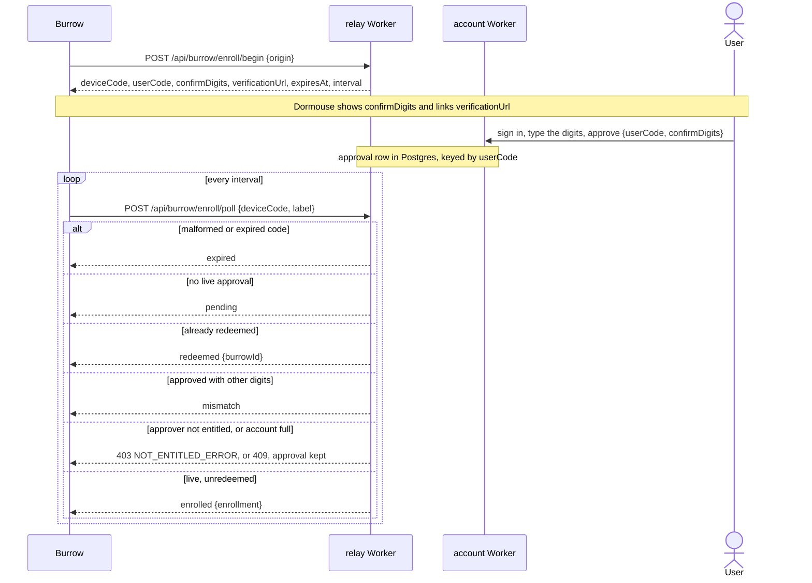

# Dormouse Hosted accounts

> - See `docs/specs/glossary.md` for Burrow, Client, Relay, and Session vocabulary.
> - Owns the Hosted account application, the Hosted Relay's account-scoped routes and sockets, and the deployment of Hosted's three Workers. The one-time rendezvous the relay Worker serves belongs to `docs/specs/one-time.md` -> "Hosted rendezvous"; the Relay's shared route and routing semantics to `docs/specs/relay.md` -> "HTTP API" and "Routing"; remote authorization to `docs/specs/remote-security-model.md`.

## Application boundary

**Must serve Hosted as three Workers from `hosted/`, one origin each:**

| Worker | Origin | Serves | Holds |
|---|---|---|---|
| `dormouse-hosted` | `https://hosted.dormouse.sh` | the account frontend, `/api/auth/*`, `/api/providers`, Natural Voice on or off, the Relay's account routes ("Burrow enrollment"), billing, Stripe's webhook, and the founders row ("Billing") | the login cookie, auth secrets, Hyperdrive, the approval rate limit, a binding to the relay's `RelayRoom`, the Stripe bindings |
| `dormouse-relay` | `https://relay.dormouse.sh` | the Hosted Relay, its sockets, and Pocket ("Relay", "Relay sockets"), the one-time rendezvous and `/connect/` (`docs/specs/one-time.md` -> "Hosted rendezvous") | Hyperdrive, `OneTimeRoom`, `RelayRoom`, the one-time, sign-in, setup, and enrollment rate limits, `ACCOUNT_ORIGIN`, `RELAY_ENROLL_SECRET`, the VAPID pair |
| `dormouse-voice` | `https://voice.dormouse.sh` | speak, a token's own delete, and the history sweep ("Managed voice") | `ELEVENLABS_API_KEY`, Hyperdrive |

Every Worker answers `/api/health` and `/api/ready`, 404s anything else under its non-page prefixes (`/api`, and the relay's `/ws` too), `/dev/*`, or `/__test/*`, and answers a thrown request 503 under `secureHeaders`. `/api/ready` answers 200 once a query its role must be granted runs through its Hyperdrive, else a bare 503; it reads no row and has no rate limit. The account falls back to its SPA assets, the relay to Pocket's. Origin and binding isolation: `docs/specs/security-hosted.md` -> "Origin boundary" (rationale).

**Must keep serving `/account` on the account origin**: every desktop since v1.2.0 opens it by a hard-coded path.

**Must run committed Better Auth migrations before deploying code that needs them, never during a Worker request.** Postgres is reached through an uncached Hyperdrive binding, one per Worker.

**Must grant `dormouse_relay` and `dormouse_voice` only what `hosted/server/runtime-roles.sql` lists, never default privileges**, so a new table needs a grant there; each reaches only its Worker's tables and the entitlement's user columns and `owner_access` view, the relay inserts approved voice tokens ("Managed voice"), and both add to the daily counts ("Metrics"). **Must bind each production Worker to its own Hyperdrive connecting as its role**: account `dormouse_app`, relay `dormouse_relay`, voice `dormouse_voice` (`PRODUCTION` in `hosted/scripts/production.mjs`).

**Must install released core, auth, and stripe packages from npm and commit their lockfile integrity hashes.** The installed packages' `dist/provenance.json` must name the same clean pgstencil commit; no runtime import depends on a sibling checkout. The auth and billing migrations remain owned by their packages; Dormouse's own tables migrate from `hosted/server/dormouse-migrations/`. **Never read `pgstencil_billing.accounts` or `checkouts`, or restate its access rule**: `@pgstencil/stripe`'s helpers and `owner_access` view answer those. **Never edit a merged migration**: a migrated database never reruns one, so append the next number (pinned by `hosted/server/tests/migrations.test.ts`).

**Must declare every required peer dependency of the installed packages in `hosted/package.json`'s `dependencies`**, so they share Hosted's copy and Renovate updates them. **Never put an optional peer (pgstencil's tooling) in `dependencies`.**

Source of truth: `WORKERS` in `hosted/scripts/workers.mjs`; `workerApp` in `hosted/server/worker-app.ts`; `verifyPackages` in `hosted/scripts/production.mjs`; `hosted/server/runtime-roles.sql`. Pinned by `hosted/server/tests/boundary.test.ts` and `hosted/server/tests/runtime-roles.test.ts`.

## Identity and login

**Must retain independent simultaneous browser logins.** Login lifetime is 24 hours without refresh or cookie caching; logout revokes only the current login. These authentication records are not terminal Sessions.

**Must require explicit provider connection from a login less than ten minutes old.** The callback must retain that same live login. Matching email alone never connects an unbound OAuth identity. Different verified provider emails are allowed; an identity already attached to another account cannot be claimed.

**May create provider-only accounts without verified email.** Public email is null; pgstencil's internal placeholder is never a delivery address. Email-code login remains an access path to an account's canonical verified mailbox. No merge, email adoption, unlink, or account-recovery interface exists.

**Must identify accounts by immutable user ID, never email.** Provider-only accounts keep their identity when a provider subsequently supplies email. Exceptions: `ADMIN_EMAIL` ("Entitlement") and `SIGN_IN_ALLOWLIST` (below).

**Must sign in only `SIGN_IN_ALLOWLIST`'s verified emails, in production, until launch.** A request naming another email is refused before a code is sent or an account created; on any read but a provider callback or the CSRF challenge, a login whose user is not a listed verified email has all its user's logins deleted before the auth handler answers. Signed out, the frontend shows its pre-launch notice instead of the sign-in form unless the URL carries `?signin` or a failed callback's `?error`, or the account lookup failed. The test entry runs without the gate; previews and local development keep it off. Ends at launch (Future item 4).

**Must enable providers explicitly in `OAUTH_PROVIDERS`.** The allowed set is GitHub, Google, Microsoft, and Apple. Missing paired credentials or unknown names fail closed; unused credentials enable nothing. Email uses Postmark in production and local capture in development.

**Must discard provider tokens after identity verification and omit login tokens from browser JSON.** Cookies and upstream identity verification follow the packed adapter. Cookie reads: `docs/specs/security-hosted.md` -> "Origin boundary".

Source of truth: `hosted/server/providers.js`; `authPolicy` / `providerBindings` in `hosted/server/policy.ts`; `prelaunchAuth` in `hosted/server/prelaunch.ts`.

## Interface

**Must link the account footer to the public Hosted privacy policy and terms.**

**Must show configured sign-in methods only.** Login tokens never enter browser storage, and only public identity fields render, without provider images or external assets. **`/checkout` keeps only its plan and ref in `sessionStorage`, for ten minutes**, so they survive a provider's sign-in, which returns to `/account`; `/billing` confirms the `?checkout=` Stripe returns with once and strips it.

**Must be built from the dormouse.sh reference pages' own design** (`lib/src/site/`), never a copy of it: their theme and picker, offered without the theme store, the site's Ubuntu faces served from Hosted's own origin, and the site header. It loads no marketing scripts or analytics.

Source of truth: `App` in `hosted/src/App.tsx`; `takeCheckout` in `hosted/src/billing.ts`; `useDocsThemedBody` in `lib/src/site/docs-paint.ts`.

## Terms acceptance

Continuing past the sign-in notice is how an account agrees to the Hosted terms (`website/src/pages/Terms.tsx` -> "The service").

- **Must show the notice beside every sign-in method**, naming `TERMS_VERSION` and linking the terms and privacy policy without leaving the page.
- **`TERMS_VERSION` is the policy pages' revision date** and changes with every terms revision.
- **Must record each account's first acceptance of each version**, after a sign-in that continued past the notice, current version only.

Source of truth: `termsRoutes` in `hosted/server/terms.ts`; `TERMS_VERSION` in `hosted/server/policy-constants.ts`.

## Entitlement

**Must read the entitlement (`docs/specs/pricing.md` -> "Checkout and entitlement") on the server, per request, through one SQL predicate over the account's `"user"` row**, so a bearer and its owner's entitlement resolve in one query.

- **Must entitle an account only while `@pgstencil/stripe`'s `owner_access` view grants it access** by the database's clock, as `status()` reads it: exactly one current subscription, `active` before its period end or `trialing` before its trial end. **Never entitle it while a payment dispute is open** ("Billing").
- **Must entitle `ADMIN_EMAIL` as a standing comp** while it is the account's verified email, one of the exceptions to "never email" ("Identity and login"); nothing else may key on an address.

Source of truth: `entitledSql` and `entitled` in `hosted/server/entitlement.ts`; `cookieEntitled` in `hosted/server/account-gate.ts`.

## Billing

The account Worker bills through `@pgstencil/stripe` (`docs/specs/pricing.md` -> "Checkout and entitlement").

| Route | Credential | Success |
|---|---|---|
| `GET /api/billing` | login cookie | 200 `{ plan, price, active, until, renews, entitled, suspended, founding, founder, consent, withdrawal, withdrawn }`; `plan` names a subscription Stripe still holds; closed, 200 `{ closed: true }` |
| `POST /api/billing/checkout` | login cookie, exact `Origin`, JSON `{ plan, ref?, terms, autoRenew, price }` | 200 `{ url }` of Stripe Checkout |
| `POST /api/billing/confirm` | login cookie, exact `Origin`, JSON `{ checkout }` | 200, the `GET` body |
| `POST /api/billing/portal` | login cookie, exact `Origin` | 200 `{ url }` of the customer portal |
| `PUT /api/billing/founder` | login cookie, exact `Origin`, JSON `{ shown, name? }` | 200, the `GET` body; leaving, 204 |
| `POST /api/billing/withdraw` | login cookie, exact `Origin`, JSON `{ subscription }` | 200, the `GET` body |
| `POST /api/billing/webhook` | `Stripe-Signature` over the raw body | 200 once `webhook()` committed |
| `GET /api/hosted/cohorts` | none | 200 `{ cohort?, seatsLeft?, founders: { total, shown } }` |
| `GET /api/hosted/founders/<token>` | none | 200, a shown founder's picture |

Errors are JSON `{ message }`. The cookie routes need no entitlement, answer 401 without a login, and cap a body at 4 KiB.

- **Must keep billing closed without all five bindings**: the secrets `STRIPE_SECRET_KEY` and `STRIPE_WEBHOOK_SECRET`, and the vars `STRIPE_PRICE_MONTHLY`, `STRIPE_PRICE_YEARLY`, and `STRIPE_PRICES_FOUNDING` (cohort order); closed, every cookie route past the login gate but `GET` and leaving the founders row answers 409 `CHECKOUT_CLOSED`, the webhook and the cohort read 503 `CHECKOUT_CLOSED`, and the resync reads nothing. **Must refuse a founding list whose length differs from `FOUNDING_LADDER`**, or a malformed or repeated Price. Live mode follows the key's prefix.
- **Never offer a trial or Managed Payments; must enable Stripe Tax on every Checkout.**
- **Never take a Price, customer, owner, quantity, or return URL from a request**: checkout takes a plan name and a `ref`, normalized as `checkoutRef` does; the owner is the login, its email only once verified (else Checkout asks), and Stripe returns to `/billing`. A checkout open for another plan is expired first (`replace`); a held subscription refuses another with 409.
- **Must start a checkout only after agreement to `TERMS_VERSION` and to automatic renewal at the `price` the page showed, recorded in `dormouse_checkout_consents` before its URL is answered**; another version answers 409 `TERMS_CHANGED`, and a checkout whose Price `priceCatalog` does not price at `price` is refused (`expectPrice`) with 409 `PRICE_CHANGED`. `GET` shows the latest while a subscription is held.
- **Must add or rename a founders-row name (`dormouse_founders`) only while `subscribedSql` holds on the founding Prices** (else 409) and `isFounderName` accepts it; leaving always works, a rename keeps `shownSince`. Checks: `docs/specs/security-hosted.md` -> "Account boundary".
- **Must verify the webhook's signature over the raw body before any write** and answer 2xx only once `webhook()` has committed, any other failure 503, which Stripe retries.
- **Must end at once the subscription a fully refunded charge or a lost dispute's charge paid for**, found through its invoice, while it is the owner's current one: `billing.end` with reason `refund`, after the commit and on every delivery until ended. A partial refund ends nothing, nor does a charge for an earlier subscription or none, which is logged for the operator.
- **Must offer the online withdrawal only from the held subscription while `withdrawalOffer` holds**, once per subscription; else withdraw answers 409 `WITHDRAWAL_CLOSED`. A withdrawal (`dormouse_withdrawals`) is recorded with its acknowledgement, a `withdrawal` notice, then settled: its subscription ended at once (reason `withdrawal`), every paid invoice payment refunded in full, stamped once done; the cron retries a failed settlement for 30 days and fails each run until it is settled (`hosted/README.md` -> "Refund by hand"). **Never stamp a withdrawal or closure settled while a payment it refunds was paid outside Stripe.** Checks: `docs/specs/security-hosted.md` -> "Account boundary".
- **Must suspend, never end, on an open dispute**, by its current status read from Stripe, not the event (`dormouse_billing_disputes`, which outlives the account); closing in the account's favor restores it.
- **Must offer founding at the last ladder step bought at while its purchases net of those ended within `REFUND_DAYS` are short of `FOUNDING_COHORT_SIZE`, else the next**, counting seats left the same way; an earlier step never reopens. Past the last step, founding checkout answers 409.
- **Must answer `/api/hosted/*` without resolving a login**, each answer reused for `COHORT_CACHE_MS` per isolate; `total` counts founding purchases net of refunds. The site's Worker forwards it from `dormouse.sh` to this origin, so the 421 gate needs no exception. What it answers and fetches: `docs/specs/security-hosted.md` -> "Account boundary".
- **Must resync, every 10 minutes from the account's Cron Trigger, a bounded batch of stale owners** (`reconcileStale`), finish a bounded batch of unsettled withdrawals and closure refunds, reread the least recently checked open disputes from Stripe as their webhook would, and run the notices ("Billing notices"); a failure fails the invocation after every one was tried.
- **Must grant the account's role the `pgstencil_billing` schema from `runtime-roles.sql`**, additively: the package's migration creates it.

Source of truth: `billingSetup`, `withBilling`, `resyncBilling`, and `END_REASONS` in `hosted/server/billing.ts`; `billingRoutes` and `disputeAction` in `hosted/server/billing-routes.ts`; `withdrawalOffer` and `recordWithdrawal` in `hosted/server/withdrawal.ts`; `cohortRoutes` in `hosted/server/cohort-routes.ts`; `forwardHosted` in `website/public/_worker.js`. Pinned by `hosted/server/tests/billing.test.ts` and `hosted/server/tests/billing-routes.test.ts`, on StripeDev.

## Billing notices

Each notice is a `dormouse_billing_notices` row, recorded before it is sent and stamped once Postmark accepts it, one per kind and renewal, dispute, or withdrawal.

| Kind | Due | Still sent while |
|---|---|---|
| `renewal` (yearly and founding, doubling as their annual reminder) | 30 days before the renewal | the subscription is `active` and renews then |
| `annual` (monthly) | 30 days before each renewal ending a year since its start | the same |
| `price_change` | 21 days before the first renewal on or after the change's `effectiveAt` | the same, on the old Price, over 8 days ahead |
| `dispute_suspended` | a dispute opens a suspension | the dispute is open, for 30 days |
| `dispute_restored` | it closes in the account's favor, no other open | 30 days |
| `withdrawal` (its acknowledgement) | a withdrawal is recorded, in the same statement | 30 days |

- **Must send every notice to the Stripe customer's email**, never the sign-in email, so a provider-only account gets them.
- **Must record a dispute's notice in the webhook's transaction** and send it after the commit; a failed send never fails the event.
- **A price change is an operator's `dormouse_price_changes` row** (`hosted/README.md`); both its Prices grant the plan once inserted. **Never act on one naming a founding Price or another plan's**, or whose Prices Stripe does not hold at its amounts, in USD, at the plan's interval.
- **Must move a subscription to the new Price, without proration, only after its notice was sent at least 7 days before the renewal it names**, while Stripe still renews it then on the old Price; a later notice waits for the next renewal. Checks: `docs/specs/security-hosted.md` -> "Account boundary".

Source of truth: `runNotices` and `sendNotices` in `hosted/server/notices.ts`; `recordDispute` in `hosted/server/billing-routes.ts`; `hosted/server/dormouse-migrations/018_billing_notices.sql` and `hosted/server/dormouse-migrations/020_withdrawal_notices.sql`.

## Account closure

| Route | Credential | Success |
|---|---|---|
| `POST /api/account/close` | login cookie, exact `Origin`, JSON `{ close: true }` | 204, the account deleted |

Errors are JSON `{ message }`; it needs no entitlement and works with billing closed. What the page says first: `docs/specs/pricing.md` -> "Checkout and entitlement".

- **Must refuse a login older than `LOGIN_FRESH_AGE_MS`** with 403 `CLOSE_RECENT_LOGIN`, and, billing closed, an account with a current subscription row with 409 `CLOSE_UNAVAILABLE`.
- **Must expire an open checkout, then end every current subscription in Stripe (reason `closure`), before one statement records the closure (`dormouse_account_closures`) and deletes the `"user"` row**; rows without a foreign key stay. Its Burrows' and sessions' sockets then close as removals' do ("Relay sockets"). Checks: `docs/specs/security-hosted.md` -> "Account boundary".
- **Must then refund what closing owes** (`docs/specs/pricing.md` -> "Checkout and entitlement"): a first payment while `purchaseStanding` counts the end a refund, a yearly or founding renewal paid within `REFUND_DAYS` of it. The closure is stamped settled once done, as a withdrawal is ("Billing").

Source of truth: `closureRoutes` in `hosted/server/closure.ts`; `CloseAccount` in `hosted/src/Closure.tsx`.

## Managed voice

A desktop with Natural Voice on exchanges its voice token for ElevenLabs speech in a voice of the curated set (`MANAGED_VOICES` in `remote-lib-common/src/remote/managed-voice.ts`). A voice-purpose device-code approval ("Burrow enrollment") mints only the token at redemption.

| Route | Credential | Success |
|---|---|---|
| `GET /api/voice` | login cookie, same-origin fetch | 200 `{ entitled, on }`, `on` while the account holds a live token |
| `DELETE /api/voice` | login cookie, exact `Origin` | 204, the account's tokens deleted |
| `POST /api/voice/speak` | `Authorization: Bearer dmv_…`, JSON `{ text, voiceId }` | 200 `audio/mpeg`, `Cache-Control: no-store` |
| `DELETE /api/voice/token` | `Authorization: Bearer dmv_…` | 204, that token deleted, live or not |

Errors are JSON `{ message }`. Cookie routes answer 401 without a login and admit any account, entitled or not, so a lapsed one can still turn Natural Voice off.

**Must store only a token's SHA-256, and nothing about the computer holding it.** A token is `dmv_` plus base64url of 32 random bytes, returned only by the poll that redeems a voice approval.

**A token is live until a year (`VOICE_TOKEN_IDLE_DAYS`) passes without a counted speak, or since its mint if none**; speak and `on` refuse any other. **Must delete expired tokens from the voice Worker's daily Cron Trigger (`TOKEN_SWEEP_CRON`)**, its only database pass (rationale).

**Never name a token, or list computers, on the account page.** It says whether Natural Voice is on, and turning it off asks first.

**Must keep managed voice and remote control independent.** Voice approval mints only a voice token, remote enrollment only a Burrow; turning either off preserves the other. The relay's role may insert only the voice token's owner and hash. Client controls and disclosure: `docs/specs/alert.md` -> "Settings dialog".

**Speak must answer in this order:**

1. 401 for a missing, malformed, unknown, or expired token.
2. 403 when the owner is not entitled.
3. 400 for malformed JSON, `text` outside 1–200 characters after trim, or a `voiceId` outside the curated set.
4. 503 when the deployment has no `ELEVENLABS_API_KEY`.
5. 429 once the owner's UTC-day counter reaches 500. The atomic increment precedes the upstream call, so failed upstream attempts count.
6. 502 when ElevenLabs throws or answers non-2xx.

**Never log the text or forward an upstream body or status.** The upstream URL, model, and format (`mp3_44100_128`, so 200 characters stay under a shipped desktop's `MAX_AUDIO_BYTES`) are fixed in code; no binding or request field redirects them. `ELEVENLABS_API_KEY` is the voice Worker's secret, which production preflight requires there.

**Must delete ElevenLabs speech history, which keeps each generation's text, from the production voice Worker only**: one pass shortly after each successful speak, and a Cron Trigger every 5 minutes for what that missed. No retention bound is guaranteed (rationale).

- **Must use an ElevenLabs service account dedicated to Dormouse voice, with history access isolated from other workspace usage.** A sweep deletes every history item visible to its key (rationale).
- **Never touch the database or any binding but `ELEVENLABS_API_KEY` in a history sweep**, so an idle deployment lets Postgres suspend. Without the key nothing runs; development and previews never sweep.
- **Must fail the cron invocation when its pass cannot list or any delete fails; the after-speech pass only logs** (rationale).

Source of truth: `hosted/server/voice.ts`; `hosted/server/voice-app.ts`; `mintVoiceToken` in `hosted/server/voice-token.ts`.

## Relay

The relay Worker serves the self-host Relay's HTTP API to many accounts: the paths, shapes, statuses, and error strings of `docs/specs/relay.md` -> "HTTP API", "Setup tokens and the pairing QR", and "WebAuthn without a WebAuthn library", so a Burrow and Pocket cannot tell the two apart; both run the checks and bounds in `remote-lib-common/src/remote/relay-common.ts`. Assertions demand presence, not verification. Security checks: `docs/specs/security-hosted.md` -> "Relay boundary". Only the differences:

| Route | On Hosted |
|---|---|
| `POST /api/setup/begin`, `/finish` | The passkey joins the account owning the token's Burrow, recorded as that Burrow's: `accountId` is its user ID, `existingCredentialIds` its passkeys; 409 at `MAX_PASSKEYS_PER_ACCOUNT`, naming the account page; `finish`'s session counts toward `MAX_SESSIONS_PER_ACCOUNT` as sign-in's does |
| `POST /api/setup/retire` | Spends only a token one of the session's account's Burrows minted |
| `POST /api/signin/finish` | The asserted credential's account; `accountId` is its user ID. 401 `NOT_ENTITLED_ERROR`, and no session, for an account not entitled |
| `POST /api/reauth/begin`, `/finish` | Only the session's account's credentials and nonces |
| `GET /api/burrows` | The session's account's Burrows, each `online` while it holds a live socket in the account's `RelayRoom` ("Relay sockets") |
| `POST /api/burrow/setup-token` | 401 for a removed Burrow, 403 `NOT_ENTITLED_ERROR` for an owner not entitled |
| `POST /api/burrow/enroll` | Always 401 `UNAUTHORIZED_ERROR`: Hosted has no setup password; a Burrow enrolls by device code ("Burrow enrollment") |
| `GET /api/push/config` | The VAPID public key, or `null` when push is off ("Push") |
| `POST /api/push/subscribe` | 404 for a Burrow not the session's account's; 400 `endpoint must be a known push service` off the allowlist ("Push") |
| `POST /api/push/subscriptions/query`, `DELETE /api/push/subscriptions/:deliveryId` | Only rows of the session's account's Burrows |
| `POST /api/push/send` | A recipient repeating an earlier one's `deliveryId` is not sent again and counts as `unknown` (rationale) |
| `GET /api/hello` | 404: the self-host installers' probe |
| `GET /*` | Pocket (below) |

A session-gated route answers a session of an account no longer entitled with the expired session's 401 `UNAUTHORIZED_ERROR`, so Pocket returns to sign-in.

- **Must keep the Relay's state in Postgres** (`hosted/server/dormouse-migrations/002_relay.sql`), sessions, challenges, and nonces included, where the self-host Relay holds them in memory.
- **Must resolve each bearer and its owner's entitlement in one query**, the socket upgrades' query-parameter token included. The entitlement: "Entitlement".
- **Must cap every table a caller grows, keyed by whoever grows it**, as `docs/specs/relay.md` -> "Guardrails" does: setup tokens and setup challenges per Burrow (`MAX_TOKENS_PER_BURROW`), presence nonces per session (`MAX_PENDING_REAUTH_NONCES_PER_SESSION`), and sessions per account (`MAX_SESSIONS_PER_ACCOUNT`), each evicting its key's own oldest; passkeys per account are refused at the cap (rationale). A capped write prunes, trims, and evicts only its own key's rows.
- **Must sweep every Relay table's expired rows from the relay's hourly Cron Trigger** (rationale); sign-in challenges, minted unauthenticated and flat, are bounded by it and the per-address limit.
- **Must answer 429 with `Retry-After` past the per-address limit on `signin/*` (`RELAY_SIGNIN_LIMIT`) and `setup/begin`/`finish` (`RELAY_SETUP_LIMIT`)**, before the body limit and any database read: 30 a minute, a ceremony's two routes sharing one budget (rationale).
- **Must claim a setup token in place at `finish`**, so a retire still finds it; a refused `finish` clears its claim, or spends the token when its owner is not entitled, so the token keeps its expiry and stays dead once retired, evicted, or swept.

**Push.** The push routes keep `docs/specs/relay.md` -> "Web Push" and its "State files" upsert rules; a send is HTTPS from the Burrow to the relay Worker, independent of terminal transport.

- **Must keep subscriptions in Postgres** (`hosted/server/dormouse-migrations/003_relay_push.sql`), keyed `(burrowId, deliveryId)`, every field bounded as self-host bounds it, deleted with their Burrow. **Must read the addresses a delivery moves off, drop rows, and prune 404/410 among the account's rows only.**
- **Must cap subscriptions at `MAX_PUSH_SUBSCRIPTIONS_PER_BURROW` and `MAX_PUSH_SUBSCRIPTIONS_PER_ACCOUNT`** in place of self-host's file total, evicting the oldest `subscribedAt`, never the row just written (rationale). A subscribe racing its Burrow's removal answers 404.
- **Must register and fetch only a known Web Push service's endpoint** (`knownPushEndpoint`) in place of the self-host DNS guard: `https:` on the default port, no credentials, at most `MAX_PUSH_ENDPOINT_LENGTH`, and host `fcm.googleapis.com` or `updates.push.services.mozilla.com`, or one under `.push.apple.com` or `.notify.windows.com` (rationale). **Never follow a redirect**: a 3xx is `failed`. A refusal's log keeps at most 1 KiB of its body.
- **Must send through `webPushRequest`** (`remote-lib-common/src/remote/web-push.ts`), WebCrypto with no `web-push`: RFC 8291 `aes128gcm` and an RFC 8292 VAPID JWT whose `sub` is the relay's `APP_ORIGIN`, each delivery bounded by `PUSH_SEND_DEADLINE_MS`. **Never hold a Postgres connection across a push service's fetch.**
- **Push is disabled, not half-working**: without both `RELAY_VAPID_PUBLIC_KEY` and `RELAY_VAPID_PRIVATE_KEY`, with malformed keys (including noncanonical base64url), with a private key that does not sign for its public point, or without an https, non-loopback `APP_ORIGIN` for the subject, the config route answers `null` and subscribe and send 503. The pair is a relay Worker secret; previews derive theirs ("PR previews"), and the dev loop has none.

**Pocket at the root.** Pocket is served per `docs/specs/pocket-app.md` -> "Serving the built bundle", except that a path naming no file (no extension, outside `/diagnostics`) always gets the shell.

Source of truth: `relayApiRoutes` in `hosted/server/relay-api.ts`; `pocketRoutes` in `hosted/server/pocket.ts`; `hosted/wrangler.relay.jsonc`. Pinned by `remote-lib-common/test/web-push.test.mjs` (the RFC 8291 Appendix A vector).

## Relay sockets

The relay Worker serves `GET /ws/burrow` and `GET /ws/client` at the self-host paths, token in `WS_TOKEN_PARAM`, and routes them by `docs/specs/relay.md` -> "Routing", every rule, through the same frame layer and bounds. Only the differences; `docs/specs/security-hosted.md` -> "Relay boundary" holds the checks.

| Route | Admitted | Refused |
|---|---|---|
| `GET /ws/burrow` | no `Origin`, a Burrow token whose owner is entitled | 403 `forbidden` with any `Origin`; 401 `UNKNOWN_BURROW_TOKEN_ERROR`; 403 `NOT_ENTITLED_ERROR` |
| `GET /ws/client` | `Origin` exactly `APP_ORIGIN`, a live session of an entitled account | 403 `forbidden`; 401 `UNAUTHORIZED_ERROR` for any session refused, which Pocket's probe of `GET /api/burrows` reads as expiry |

- **Must route each account's sockets through one `RelayRoom` Durable Object, named `idFromName(userId)` from the account the token resolved to**, holding all its Burrow and Client sockets. Another account's Burrow is in another object, so a cross-account binding is impossible, not refused.
- **Must hand the object a fresh request**: the upgrade, the account, and the Burrow's id or the session's `expiresAt` and token hash as search parameters (`RELAY_ROOM_PARAMS`); never a header, token, or cookie of the caller's.
- **Must store only the account id**; a request or RPC naming another account is refused and logged with no frame content.
- **Must recheck a Burrow's row in the object before accepting its socket**, under `blockConcurrencyWhile`: enrolled, the account's, its owner entitled, else the Worker's 401 or 403, so a removal committed after the Worker's token check is refused. **Never open a database connection in the object** (rationale): it reads rows through the relay Worker's `RelayRows` entrypoint. **Must bound every row read at `RELAY_ROW_READ_TIMEOUT_MS`**: past it the upgrade answers 503 and the sweep leaves its Burrows to the next.
- **Must accept every socket through the Hibernation API**, its routing state in the socket's attachment.
- **Must measure a frame against `MAX_RELAY_FRAME_BYTES` before parsing it**, a text frame in UTF-8 bytes as the self-host `maxPayload` counts, closing 1009 past it; an under-cap binary frame is dropped. The Client cap is per account object.
- **Must close, from the object's alarm, every Client whose session expired, went, or lost the entitlement 1008 `unauthorized`** (its Burrow told `client-gone`) **and every removed or another account's Burrow 4001 (`WS_CLOSE_BURROW_REVOKED`) and de-entitled one 4002 (`WS_CLOSE_BURROW_NOT_ENTITLED`)** (its Clients told `burrow-gone`): the alarm fires at the earliest held Client's `expiresAt` and, while any socket is held, at most `RELAY_ROOM_SWEEP_MS` (an hour) apart. It replaces the self-host expiry and revocation sweeps.
- **Must answer `RELAY_PING` with `RELAY_PONG` as the object's auto-response**, which never wakes it, reaches no handler, and is never forwarded. **A socket unheard from for longer than `RELAY_IDLE_TIMEOUT_MS` is gone**, retired with 1001, counted from its last auto-response or, before its first ping, from its opening. It replaces the self-host heartbeat. One gap is accepted: at the Client cap a backgrounded Pocket, its pings paused, counts as gone once silent that long, the Burrow reaping its session at 120 s anyway.
- **Must close a removed Burrow's socket from the account Worker's `DELETE /api/relay/burrows/:burrowId`**, through its `RELAY_ROOM` binding calling `closeBurrow`: 4001, its Clients `burrow-gone`; **and a removed passkey's sessions' Client sockets from `DELETE /api/relay/passkeys/:credentialId`** calling `closeSessions`: 1008, as at expiry. **Must answer 204 once the row is gone, even if the close fails**, logging it; the sweep closes the socket. `GET /api/burrows` reads `online` through account-scoped `onlineBurrows`. **Never expose an RPC or `RelayRows` as a public endpoint.**

Source of truth: `relaySocketRoutes` in `hosted/server/relay-sockets.ts`; `RelayRoom` in `hosted/server/relay-room.ts`. Pinned by `hosted/server/tests/relay-room.test.ts`, which also runs the routing cases every Relay passes (`remote-lib-common/test/harness/relay-parity.mjs`).

## Burrow enrollment

A device code joins a Burrow to an account; its ACL still authorizes Clients. The relay serves begin and poll, the account the rest. Desktop behavior: `docs/specs/relay.md` -> "Burrow side".

The pre-launch sign-in gate is "Identity and login".

Begin refuses an absent or mismatched origin with `ORIGIN_MISMATCH_ERROR`. The verification link points to the account's `/enroll` page, with the user code in its fragment and voice purpose in its query. `redeemed` names the Burrow whose answer was lost; 409 names the account page at the abuse ceiling `MAX_BURROWS_PER_ACCOUNT` (`docs/specs/pricing.md` -> "Checkout and entitlement").

- **Never write from begin.** The device code is 32 bytes, the bearer shape: its expiry in its leading bytes, the rest random. The user code is `enrollUserCode` under `RELAY_ENROLL_SECRET` for remote enrollment, or that secret suffixed with `:voice` for managed voice (rationale). The confirmation digits are `enrollConfirmDigits` of the user code under `RELAY_ENROLL_SECRET`; the link carries the user code, never the digits.
- **Must redeem only an approval whose typed digits are its code's confirmation digits, compared at the poll** (rationale). Any other answers `mismatch` to every poll until it expires: one attempt per code. The first such poll stamps the live, unredeemed approval's `mismatchedAt` for its approver's waiting page.
- **Must store the approval alone** (`dormouse_relay_enrollment_approvals`): it cannot tell an issued code from any well-formed one, so it approves any; one no Burrow redeems expires (rationale).
- **Never admit a begin or poll request carrying `Origin`** (403): only a Node Burrow calls them. Then 429 with `Retry-After` past `RELAY_ENROLL_BEGIN_LIMIT` (10 a minute per address) or `RELAY_ENROLL_POLL_LIMIT` (60), before the body limit and any database read.
- **Must answer an expired device code from the code alone**, reading no database.
- **Must redeem in one statement** that marks the user code's live unredeemed approval redeemed and inserts the Burrow owned by its `userId`, under the account's lock with the cap check, so two polls mint one Burrow. The entitlement is rechecked first.
- **Must store the label a remote poll carries, reduced by `reduceBurrowLabel` (64 code points, no control, format, or separator characters), never refusing the poll over it**; the column's CHECK refuses what the reduction strips.
- **Must keep a redeemed approval until it expires**, swept hourly, so a poll whose `enrolled` answer was lost reads `redeemed`. **Never key it to the Burrow**: removing that Burrow leaves it redeemed; only an approval after it expires replaces it.

| Route (account) | Credential | Success |
|---|---|---|
| `POST /api/relay/enrollments/approve` | login cookie, exact `Origin`, JSON `{ userCode, purpose, confirmDigits }` | 204 |
| `GET /api/relay/enrollments/:userCode` | login cookie, same-origin fetch | 200 `{ mismatched, redeemed }`, each true only for the caller's own live approval |
| `GET /api/relay/burrows` | login cookie, same-origin fetch | 200 `{ burrows }` |
| `DELETE /api/relay/burrows/:burrowId` | login cookie, exact `Origin` | 204; 404 for another account's or an unknown ID |
| `GET /api/relay/passkeys` | login cookie, same-origin fetch | 200 `{ passkeys }`, each with the enrolled Burrow whose setup token registered it, or none |
| `DELETE /api/relay/passkeys/:credentialId` | login cookie, exact `Origin` | 204; 404 for another account's or an unknown ID |

Errors are the managed-voice cookie routes' ("Managed voice"), except that their 403 carries `NOT_ENTITLED_ERROR`.

- **Must refuse approval from a login older than `LOGIN_FRESH_AGE_MS`**, 403 `RECENT_LOGIN_REQUIRED`, failing closed when the login's `createdAt` is missing or unparsable; the voice routes require no recent login.
- **Must count every approval attempt** against `RELAY_APPROVE_LIMIT` (10 a minute per account) before reading the body: 429 with `Retry-After` past it.
- **Must answer a malformed code or digits 400**, the code forgiving case, spaces, and dashes, and a second approval of a live code 409 `ALREADY_APPROVED`, whichever account sends it: a live approval never moves. An expired one is replaced.
- **Must remove by deleting the Burrow's row**, its setup tokens and setup challenges cascading, so its token authenticates nothing on any relay route, **then close its live socket** ("Relay sockets"). **Never remove a passkey with its Burrow**: it is left with no Burrow (rationale).
- **Must remove a passkey by deleting its row**, every session it signed in cascading, so it signs in to nothing again, **then close their sockets** ("Relay sockets"); every session names the passkey that signed it in, its `"credentialId"` `NOT NULL`.
- **Must take the `/enroll` fragment before render and erase it from history, and hold the code in memory only**: through email sign-in and back, never into storage. Provider sign-in leaves the page, so the user opens the link again.
- **Must preserve newer enrollments when earlier approvals complete.**
- **Never offer the digits to an account the server says is unentitled**, and never conclude that from a failed read; the page offers another account instead.

**Must bind every approval to its purpose, defaulting omitted purpose to remote control.** Voice approvals use a distinct code derivation and scope. Voice clients require begin to acknowledge their purpose before displaying or polling a code. Voice redemption atomically marks the approval and mints a token, without a Burrow or its cap; later polls report it spent. A remote poll cannot redeem a voice approval, or vice versa. Both purposes share the digits, approval gates, and expiry.

Source of truth: `relayApiRoutes` in `hosted/server/relay-api.ts`; `relayAccountRoutes` in `hosted/server/relay-account.ts`; `takeEnrollment` in `hosted/src/enrollment.ts`.

## Metrics

Hosted's Workers count what they serve in aggregate daily rows; no page or desktop sends any.

| Event | Labels | Counted when |
|---|---|---|
| `account.created` | none | a user row commits |
| `login` | `email`, `providerIds` | a sign-in's session commits, by method; never a link |
| `enroll.approved` | `remote`, `voice` | an approval succeeds, under its purpose |
| `burrow.enrolled` | none | a remote poll enrolls a Burrow |
| `voice.speak` | `ok`, `capped`, `error` | speak answers 200, 429, or 502 |
| `voice.fallback-cap` | none | a speak spends its owner's last call of the UTC day |
| `push.sent` | none | each delivery a send makes |
| `pocket.signin` | none | a passkey sign-in mints a session |
| `checkout.started` | `plan:ref` | checkout answers a URL |
| `checkout.completed` | `plan:ref` | the webhook processes a completion (`completedCheckout`) |
| `subscription.canceled` | plan | the webhook processes a purchase's end |
| `subscription.refunded` | plan | that end's recorded reason was `refund`, or it came within `REFUND_DAYS` |

- **Never count a label off its event's list** (`METRIC_LABELS`): the write throws, and the table's CHECK refuses it. **Must replace that CHECK in a migration when the list gains a label.** Row contents and readers: `docs/specs/security-hosted.md` -> "Account boundary".
- **Never fail or delay the request a metric counts**: the write is unawaited, kept alive by `waitUntil`, and only logs failure. The webhook's counts commit in its transaction under a savepoint of their own, so a redelivery never counts twice and a failed count rolls back alone.
- Rows are kept forever (rationale). The database's UTC clock dates every row and the account Worker's `/admin/metrics` "today".

Source of truth: `hosted/server/metric-labels.ts`; `recordMetric` and `authMetricHooks` in `hosted/server/metrics.ts`; `hosted/server/dormouse-migrations/022_metric_labels.sql`; `AdminMetrics` in `hosted/src/AdminMetrics.tsx`.

## Development and release

**Must run local development with `dor tool hosted` inside Dormouse.** Its loopback `http://localhost:<port>` origin serves Vite and Node auth on a disposable development database, with the Worker's account routes (`accountRoutes`) and cron, but never the voice origin's; billing runs on StripeDev, which takes no card. Host, Origin, and Fetch Metadata checks guard the local captured-email inbox; no production entry imports an inbox or test-control handler. **It also runs the relay Worker on that database, with this origin as `ACCOUNT_ORIGIN`** (`docs/specs/one-time.md` -> "Dev loop").

**Must verify the three production Worker bundles and run the consumer's integration suite before release.** Only test entries inject deterministic Better Auth. Simulated callbacks do not certify provider registrations; production acceptance requires real browser login with each enabled provider and email delivery.

**Must keep production, test, and preview databases and credentials separate.** The development and preview entries are email-only. Production configuration and operator steps live in `hosted/README.md`.

Source of truth: `allowedDevRequest` in `hosted/server/dev-host-guard.ts`; `hosted/server/dev.ts`; `accountRoutes` and `accountCron` in `hosted/server/account-routes.ts`; `build` in `hosted/package.json`. Pinned by `hosted/server/tests/boundary.test.ts`.

## PR previews

**Must deploy only verified same-repository PR merge revisions touching Hosted or its shared build inputs, on a PR labeled `hosted-preview`.** Drafts qualify; forks receive no deployment credentials.

**Must isolate each PR in three persistent workers.dev Workers (`dormouse-{hosted,relay,voice}-pr-N`), one uncached Hyperdrive all three share, and a Neon branch from an empty dedicated preview project**, all reused until the PR closes or loses the label. That Hyperdrive connects as the branch's owner, so no preview exercises the restricted roles; `hosted/server/tests` binds the relay and voice to them (rationale). Preview configs exclude production routes, triggers, and credentials; runtime bindings cannot enable OAuth, Postmark, or ElevenLabs. **Must give each relay preview its own Durable Object namespaces, each preview preview-only rate-limit namespaces, and wire each preview to its own PR's siblings** (the account's `RELAY_ROOM`, the relay's `ACCOUNT_ORIGIN`). **Must derive every preview secret from `PREVIEW_AUTH_SECRET` and its Worker's name**, the relay's VAPID pair included, so no production key reaches a preview and subscriptions survive the PR's redeploys.

**Must sweep before provisioning, never at close:** each preview deploy first deletes every closed or unlabeled PR's preview (rationale).

**Must capture preview mail in Postgres and expose escaped text only**, on a public inbox that accepts only the preview's configured origin. No test clock is deployed. Preview data is disposable; it is not access-controlled.

Source of truth: `.github/workflows/hosted-preview.yml`; `previewConfig` / `previewSecrets` / `sweep` in `hosted/scripts/preview.mjs`; `hosted/server/preview-worker.ts`. Pinned by `hosted/scripts/preview.test.mjs`.

## Production releases

**Must deploy only manually selected main revisions after Hosted tests/build and accepted clean package provenance.** `productionConfig` holds each config to its Worker's pinned name, origin, and lone custom domain, and the relay's `ACCOUNT_ORIGIN` to the account's origin; `preflight`, before the backup, checks each Worker's Hyperdrive and its own secret names (`docs/specs/security-hosted.md` -> "Deployment boundary") — names only, as Cloudflare exposes no value. **Must back up, encrypt, decrypt, and restore-test before applying migrations**, uploading only the encrypted archive. **Must deploy relay, voice, then account, stopping at a failure**; the relay must pass its revision check, `/api/ready`, push config, and `oneTimeSmoke` before the next deploy (rationale). Production has no public candidate URL.

**Must only append Durable Object migrations**: a deployed tag is never edited or removed, and Cloudflare refuses a rollback across one, so each is a rollback floor. A deploy restarts every room, dropping links still waiting or mid-handshake, and every relay socket, which its end reconnects; a session already on its direct path never touches Hosted. Live verification checks all three Workers once the account has deployed.

**Never replay a smoke's POST after a transport failure.** Production repeats only the relay and voice smokes (rationale).

**Must record an immutable annotated hosted/YYYY-MM-DD tag only after live verification**, naming the deployed commit and verification run and attempt; retries are idempotent and redeployments get new tags. Code rollback never reverses migrations.

Source of truth: `.github/workflows/hosted-production.yml`; `hosted/scripts/production.mjs`.

## Future

**Scope: hosted-launch** — in order:

1. Deploy the configured providers and pass real production acceptance. pgstencil includes the Microsoft fix; personal and work/school callbacks need acceptance.
2. Add per-browser login listing/revocation, sign-out-everywhere, and account recovery before broad paid use. Revisit the fixed 24-hour login lifetime for daily voice use.
3. Managed voice for every member: per-account quotas, usage accounting, spending bounds beyond the fixed daily cap, and explicit text/redaction disclosure.
4. Open sign-in: delete `hosted/server/prelaunch.ts` and the frontend's pre-launch notice.
