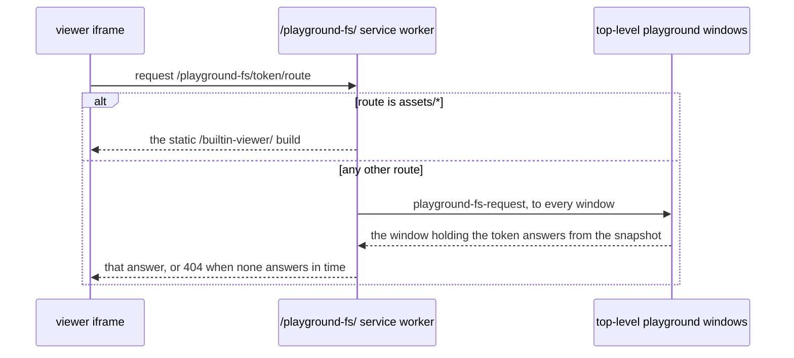

# Playground Tutorial

> See `docs/specs/glossary.md` for Session / Pane vocabulary, used here for the playground's pane layout and detection wiring.

Device routes (`website/src/routes.ts`):

- **`/playground`** — dispatcher: Pocket for coarse pointers or narrow viewports, Desktop otherwise, then **replaces** the history entry, preserving search + hash (query in `website/src/lib/playground-routing.ts`).
- **`/playground/desktop`** — desktop tiling tutorial; where the dispatcher would pick Pocket, a link to `/playground/pocket` instead of `Wall`.
- **`/playground/pocket`** — mobile Pocket playground; on desktop, the temporary Pocket marketing/share page.
- **`/pocket`** — temporary redirect to `/playground/pocket`. **Keep the real tethering surface off the playground URL.**

**Must hydrate the desktop prerender, then reconcile browser media.** **Must dispatch using browser media, never the hydration fallback.** **Must skip desktop runtime loading when browser media selects Pocket.** Pinned by `website/src/pages/Playground.test.tsx`.

## Profiles

`DESKTOP_TUTORIAL_PROFILE` and `POCKET_TUTORIAL_PROFILE` open inside their `initialSectionId`. Pocket's Copy paste is desktop's minus `cp-override` ([Pocket Copy paste specifics](#pocket-copy-paste-specifics)).

**Item ids are stable** — they are the localStorage payload entries ([Storage](#storage)).

## Architecture

**Must run the tutorial as a browser-side xterm alt-screen program behind `FakePtyAdapter`, never Node `terminal-kit`.**

**Must derive progress from app events and semantic snapshots, never touch the tiling engine.**

- **Must credit a keyboard split from its `split` event alone, whatever the mode**, and tell the user to re-enter command mode for the following navigation item.
- **Must credit `kb-arrows` only on command-mode selection of a distinct pane**; an arrow or click counts, a swap's resulting focus does not.
- **Must credit an alert ring only on a transition into `ALERT_RINGING`, by the source its detail names**, so a ring already standing when first seen credits nothing.
- **Must credit the `dor open` section from the command lines the shells report**, never from a hook in the playground `dor` or its viewers.

Source of truth: `TutRunner` in `website/src/lib/tut-runner.ts`; `TutDetector` in `website/src/lib/tut-detector.ts`; `TutorialState` in `website/src/lib/tutorial-state.ts`; profiles in `website/src/lib/tut-items.ts`.

## Layout

- **The desktop page must restore its own theme** with `useRestoredTheme(WEBSITE_DEFAULT_THEME_ID)` (rationale).
- `/playground/desktop` runs `WorkspaceWindow` (`FakePtyAdapter`, `initialMode="passthrough"`) from one fresh Workspace. **Must seed its three-pane L-shape as an explicit Lath snapshot** — `restoredLathLayout` from `DESKTOP_PLAYGROUND_LAYOUT` — never the synchronous `initialPaneIds` path (rationale); `website/src/lib/playground-desktop-layout.test.ts` pins it. `DESKTOP_PANES` in the same file owns each seed's id, command, and title; **`tut-boxed` is the Auto-copy + `cp-override` target** (rationale).

Every visible pane gets a `TutorialShell` via `PlaygroundShellRegistry`.

`/playground/pocket` runs `MobileWall` with **`pocket-tut`** (active, `TutRunner` on `POCKET_TUTORIAL_PROFILE`) and **`pocket-changelog`** (`ChangelogRunner`), and starts a `TutDetector` over the same shared stores. **Must credit Pocket gesture items only on the active tutorial Session's Gesture navigation screen**.

Source of truth: `PlaygroundDesktop` in `website/src/pages/PlaygroundDesktop.tsx`; `PocketPlayground` in `website/src/pages/PocketPlayground.tsx`.

### Pocket gesture opening screen

**Must credit both edge-scroll directions (`gn-scroll`), then all four arrows (`gn-arrows`), then Enter, then Escape, each only once its predecessor is complete**; an arrow sent before scrolling completes does not count. **Must clear partial direction counts on tutorial reset.** Keyboard input and native wheels never grant gesture credit.

**Must capture the mouse only on this screen**, and **must stop animation and release capture on leaving or disposal.** Reduced motion disables idle animation, retaining scroll movement.

Source of truth: `TutRunner` and `GestureStarfield` in `website/src/lib/tut-runner.ts`; `GESTURE_NAVIGATION_SECTION` in `website/src/lib/tut-items.ts`.

## Menu and navigation behavior

**Must consume unsupported CSI/SS3 key sequences without treating their prefix as Esc**; arrows accept CSI and application-mode SS3. Pinned by `website/src/lib/tut-runner.test.ts`.

Extras: `Starred on GitHub` (persisted separately), FlappyTerm, `Reset progress` — **none of the three ever counts toward a section's progress**.

### Runner-local intercepts

**`TutRunner` intercepts `p` to toggle `PlaceToPaste` while Copy paste is open; it is not a real Dormouse shortcut.** Desktop only.

### Pocket Copy paste specifics

Pocket reuses `cp-select` / `cp-raw` / `cp-rewrap` but drops `cp-override`: Select mode auto-overrides mouse capture for every Pocket session whose TUI captures the mouse (`docs/specs/mobile-terminal-ui.md` → "Touch mode selector"), so it never asks the user to click the cursor icon. A live prompt reflects the touch mode, neither stored nor counted.

## Fake shell behavior

`TutorialShell` ([Layout](#layout)):

* **Shell integration must be reported for every command it runs** — `OSC 633 ; A/B` around the prompt, `633 ; E` + `633 ; C` on launch, `633 ; D` on exit. WATCHING is keyed on the running command's name (`docs/specs/alert.md`), and the OSCs also keep `docs/specs/terminal-state.md`'s keystroke fallback from engaging here (rationale).
* **The Alerts section's programs, which both pages run, must ring for their own reasons, never through a tutorial hook**: `agent` works one turn, then asks with an `OSC 9`; `agent --quiet` sends nothing and rings only through the default `agent` WATCHING rule (`DEFAULT_WATCHED_COMMANDS`); `build` exits after its run. **`build` must stay unwatched**, so its exit, not WATCHING, raises the ring (rationale). Source of truth: `startAlertProgram` in `website/src/lib/alert-programs.ts`.
* **While a program runs, every input byte goes to it** — `\x03` included, which the runners treat as quit — as do bytes left in the chunk after the Enter that launched it. On exit the terminal returns to the prompt instead of restarting the program. At the prompt, `\x03` abandons the line for a new prompt and runs nothing.

**The only commands are the ones `startProgram` knows** and the desktop's `cd`, `ls`, and `pwd`; anything else prints an "Unknown command" line and exits `127`.

## Playground filesystem

The desktop shells share one read-only filesystem: the tracked files of `dor-tools-lib/`, inlined at build time and mounted at `/home/demo/dor-tools-lib`, every shell's starting directory. Beside it sits the playground's own user config at `~/.config/dormouse/dormouse.yml`, **inert**: shown, never read for rules. `website/src/lib/playground-fs/playground-fs.test.ts` pins the snapshot to `git ls-files dor-tools-lib` and the config to a warning-free user Tool file.

- **Must report the shell's directory with every prompt (`OSC 633 ; P ; Cwd=`)**: take-over and launch matching compare it (`docs/specs/dor-tool.md` → Take-over). `cd`, `ls`, and `pwd` are the filesystem builtins; nothing writes.
- **Must print each spawned non-helper terminal's first prompt from `PlaygroundShellRegistry`**; no scenario plays on the desktop, and a split Tool waits on that prompt's integration (rationale).
- **Must name `/bin/fake` as the default shell**, so a Windows visitor's Tool commands quote as posix rather than being refused as `cmd` (rationale).
- **The playground `dor` must run the real CLI (`runCli` in `dor/src/cli-core.ts`) over a playground `CliHost` and a `ControlClient` that sends each request to the Wall; what needs Node must fail `UNSUPPORTED IN PLAYGROUND`.** It serves the `__view-*` entries itself. `FakePtyAdapter.toolControl` answers `open` and `open-handlers` from the snapshot as a host with no user `dormouse.yml` does.
- **A `__view-*` entry must report its port before announcing it, and withdraw it on exit.**
- **Must serve the real viewer pages and CSPs on the Node viewers' routes, answered from the snapshot**; `save`, and a Markdown viewer's `image` and `rename`, answer `403`. The editors are unchanged, so edits stay in the page.
- **`createIframeProxyUrl` must map only a `localhost` URL under `/playground-fs/` to the page's own origin**, refusing others (`scheme`). The viewer pages carry the shim from `instrumentHtml`, so theme and the save channel connect as behind a proxy, and are same-origin with the Wall: first-party pages over a fixed snapshot.
- **The `/playground-fs/` service worker must stay stateless**, relaying each viewer request as below (rationale). It registers when the first viewer starts; without one, `__view-*` exits `1`.

Source of truth: `installPlaygroundFs` in `website/src/lib/playground-fs/index.ts`; `TutorialShell` in `website/src/lib/tutorial-shell.ts`; `website/public/playground-fs/sw.js`; `website/scripts/build-builtin-viewer.js`.

## Storage

`TutorialState` persists to `localStorage`. **Unknown ids in a stored payload are filtered on load**, so renaming an id is a one-way reset. **Both profiles share the completion key**, so **`markComplete` must reject an id outside the profile's own sections** — a Pocket detection that names a desktop-only item would otherwise arrive pre-checked. **Must share completed common items across profiles; keep absent-profile ids stored but exclude them from that profile's totals.**

**Must keep progress and reset working without storage**, pinned by `website/src/lib/tutorial-state.test.ts`.

- `dormouse-tut-v3` — JSON array of completed item ids.
- `dormouse-tut-star-v1` — `"true"` after `Starred on GitHub`.
- `dormouse-flappy-high-v1` — high score.

**Must remove all three on `TutorialState.reset()`, even when rejected stored values left progress empty.** Legacy `dormouse-tutorial-step-N` / `dormouse-tut-v2-*` keys are never read.

## Lib hooks backing the tutorial

Hooks in `dormouse-lib` / `MobileTerminalUi` that exist for tutorial observability:

- **`WallEvent.kill` / `move` / `paneAdded`** — discriminants on the `WallEvent` union. `kill` fires on every kill path, so each credits `kb-kill`. **`move` must fire on every pane swap, keyboard or drag** (rationale). **`paneAdded` fires once per pane that becomes visible**, seeds included.
- **`FakePtyAdapter.sendOutput`** — pushes data through the real protocol parser as if the PTY produced it (rationale). **Unlike `writePty` it is not suppressed while a scenario is playing.**
- **`FakePtyAdapter.onPtySpawn`** — fires synchronously inside `spawnPty`, before the scenario plays, so a page attaches a shell without racing `TerminalPane`'s mount.
- **`resolveAlertDeliveryPolicy`** (`lib/src/lib/alert-delivery-model.ts`) — the active Workspace's speech policy; **must credit `al-speak` only on a turn from off to on**, so a setting saved on an earlier visit grants nothing.
- **`MobileTerminalUi.onGestureInput`** — optional, reports radial-menu input only; **must fire before the input is sent**, so the final Escape is credited before it leaves the tutorial screen. Pinned by `lib/src/components/MobileTerminalUi.test.tsx`.
- **`MobileTerminalUi.onGestureScroll`** — optional, reports signed line counts only for edge scrolling.
- **`subscribeToActiveTheme` / `getActiveThemeId`** (`lib/src/lib/themes/`) — the active theme, watched to credit `th-theme`. **Must credit `th-theme` only on a theme change after the detector starts**, so boot-time restore cannot grant the item and choosing the startup theme after a reset still can. Pinned by `website/src/lib/tut-detector.test.ts` (rationale).

Source of truth: `WallEvent` in `lib/src/components/wall/wall-types.ts`, emitted from `lib/src/components/Wall.tsx`; `FakePtyAdapter` in `lib/src/lib/platform/fake-adapter.ts`; `MobileTerminalUi` in `lib/src/components/MobileTerminalUi.tsx`.

## Future

**Scope: tutorial-coverage**

Two `tut-boxed` scenarios close the playground's `docs/specs/mouse-and-clipboard.md` coverage gaps, needing no section change:

1. **`SCENARIO_BRACKETED_PASTE_TUI`** — closes [§8.5](mouse-and-clipboard.md#85-bracketed-paste). Emits `\x1b[?2004h` and an idle ANSI-framed view.
2. **`SCENARIO_SMART_TOKENS`** — closes [§5.1–§5.3](mouse-and-clipboard.md#51-detection). Prints one of each shape from `lib/src/lib/smart-token.ts`'s `PATTERNS`.
